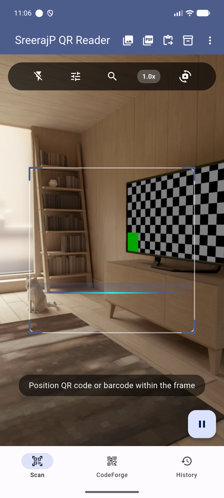
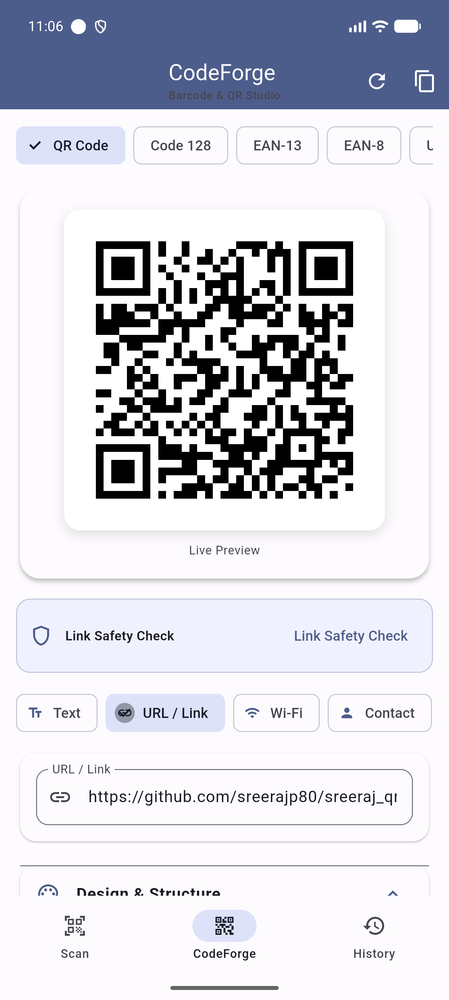
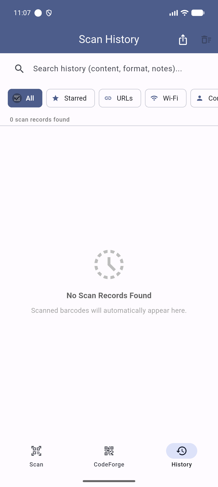
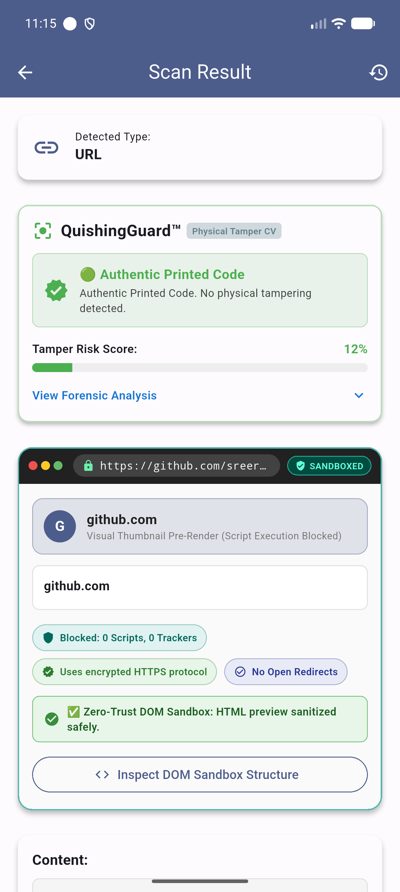
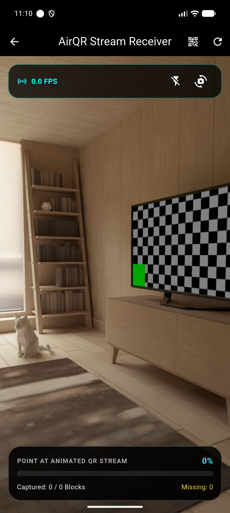
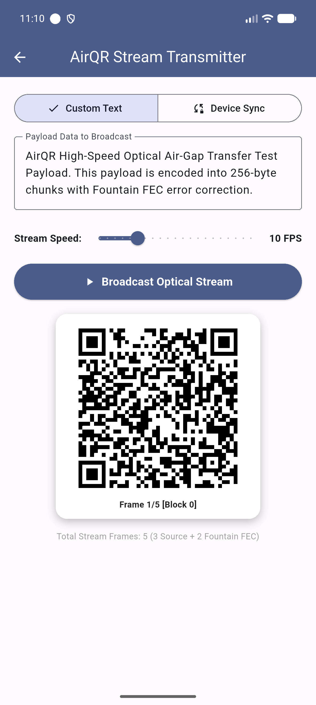
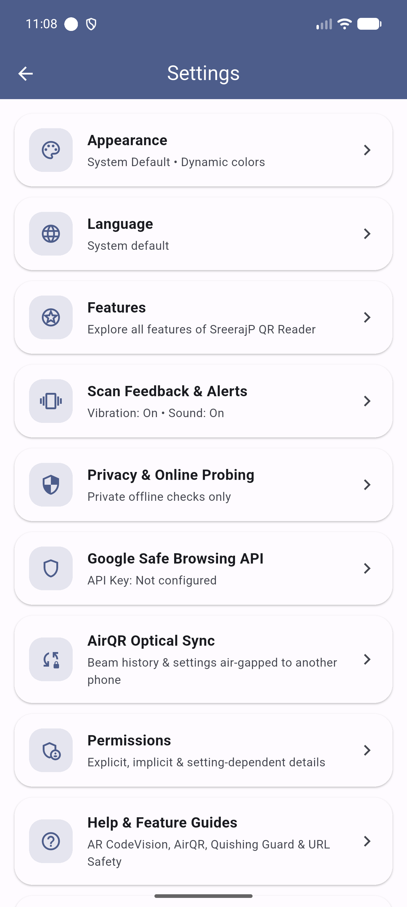
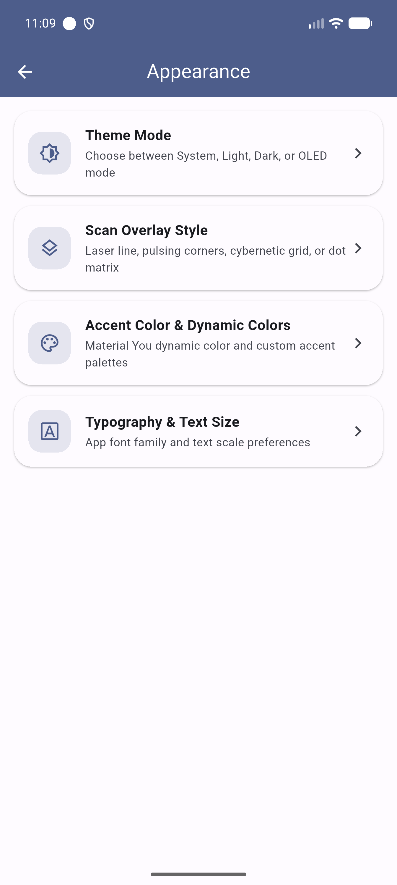
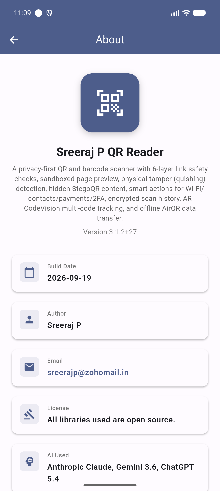

# SreerajP QR Studio

<div align="center">


**Privacy-First, Offline-First Android QR & Barcode Scanner with 6-Layer Link Safety, Multi-Provider Threat Intelligence, Quishing Guard, StegoQR Encryption, AirQR Optical Sync, and Tri-Lingual Support.**

[](https://flutter.dev)
[](https://dart.dev)
[-3DDC84?logo=android&logoColor=white)](https://android.com)
[](#-tri-lingual-localization)
[](#-security--privacy-architecture)
[](#-license)

</div>

---

## 📖 Overview

**SreerajP QR Studio** is a high-performance, privacy-focused Flutter Android application for scanning, analyzing, and creating QR codes and barcodes. Built with an offline-first architecture, it ensures that your data never leaves your device unless explicitly requested.

Beyond standard barcode decoding, SreerajP QR Studio serves as a comprehensive **security and privacy toolkit** for the physical-to-digital world:
- **6-Layer URL Safety & Threat Intelligence** protects against phishing, malicious redirects, and lookalike domains using local heuristics plus Google Safe Browsing, VirusTotal, URLhaus, PhishTank, and OpenPhish.
- **QuishingGuard™** performs on-device computer vision forensic analysis to detect physical sticker overlays on genuine QR codes.
- **Zero-Trust Sandboxed Preview** renders web destinations in an isolated, script-disabled environment with domain age (WHOIS) insights before opening.
- **StegoQR** allows secret payloads hidden within standard QR codes, encrypted with AES-256 and protected by passphrases and biometric authentication.
- **AirQR Optical Streaming & Device Sync** provides an air-gapped optical transfer mechanism (5–25 FPS animated QR sequences) to send files, encrypted scan history, and app settings between phones without Wi-Fi, Bluetooth, or cables.
- **CodeForge Studio** provides a full-featured QR and barcode generator suite with custom styling, color palettes, and embedded logos.
- **Multi-Code Viewport Selection & AR CodeVision** tracks, labels, and provides interactive touch targets for multiple barcodes simultaneously in real time.
- **Distance-Enhanced Pipeline & GhostScan™** scans distant codes using digital zoom-crop-enhancement and screen barcodes via an Android Quick Settings tile.
- **Tri-Lingual Standard**: Fully translated across **English**, **Malayalam (മലയാളം)**, and **Sanskrit (संस्कृतम्)** with live in-app switching.

---

## 📱 Visual Showcase

<div align="center">

| Live Camera Scanner | CodeForge Studio | Encrypted History |
| :---: | :---: | :---: |
|  |  |  |
| *Viewfinder with zoom, reticle & toolbar* | *QR & Barcode generator with live preview* | *Searchable, categorized scan logs* |

| Scan Result & URL Safety | AirQR Optical Receiver | AirQR Optical Transmitter |
| :---: | :---: | :---: |
|  |  |  |
| *QuishingGuard™ & Zero-Trust Sandbox* | *Optical stream capture with error recovery* | *Air-gapped animated stream broadcast* |

| Settings & Security | Appearance & Themes | About & Verification |
| :---: | :---: | :---: |
|  |  |  |
| *Privacy controls & Safe Browsing API* | *Material You, OLED black & reticle styles* | *Version, build metadata & India badge* |

</div>

---

## ✨ Key Features

### 🛡️ 6-Layer URL Safety & Multi-Provider Threat Intelligence
Every scanned link is evaluated across six rigorous security layers before the user can open it:
1. **HTTPS / SSL Protocol Validation**: Verifies secure communication channels.
2. **Redirect Chain Inspection**: Traverses HTTP redirect chains to detect evasive redirect loops and open redirect traps.
3. **Heuristic Suspicious Pattern Analysis**: Identifies raw IP hostnames, excessive subdomains, long digit strings, and phishing keywords.
4. **Known Link-Shortener Detection**: Automatically recognizes and expands shortened links (e.g., bit.ly, tinyurl) to verify true targets.
5. **Homoglyph & Lookalike Attack Detection**: Identifies internationalized domain names (IDN) using Cyrillic or Greek characters to spoof trusted domains.
6. **Multi-Provider Threat Intelligence**: Comprehensive verification against leading security engines managed from a dedicated settings screen:
   - **Google Safe Browsing**: Free personal API key integration for known deceptive and malware sites.
   - **VirusTotal v3**: Free personal API key integration querying 70+ antivirus engines with daily 500-request quota tracking and customizable endpoints.
   - **URLhaus (abuse.ch)**: Free Auth-Key integration flagging active malware distribution sites and campaigns with tags and customizable endpoints.
   - **PhishTank**: Built-in, commercial-friendly phishing verification database with a 1-tap on/off toggle (no API key needed).
   - **OpenPhish**: Built-in community feed with automatic 12-hour local caching that operates 100% offline once cached.

> **Private by Default**: Outbound threat queries run only when enabled by the user or when **Active Online Probing** is explicitly enabled. In private mode, heuristic checks run entirely on-device.

### 🔍 QuishingGuard™ Physical Tamper Detection
Protects users from real-world "quishing" (QR phishing) where attackers paste fraudulent stickers over legitimate QR codes on parking meters, restaurants, or payment terminals.
- **On-Device Computer Vision**: Analyzes camera frames surrounding the detected code.
- **Forensic Indicators**: Evaluates double edge boundaries, cast shadow steps, paper seam gradients, and print grain mismatches.
- **Scored Risk Verdict**: Delivers an instant visual score: **Authentic** (green), **Wear & Tear** (yellow), or **High Warning** (red).

### 🌐 Zero-Trust Sandboxed Web Preview
- Fetches destination pages in an isolated, script-disabled sandbox.
- Blocks JavaScript execution, iframes, trackers, and hidden meta-refresh redirects.
- Extracts page title, meta description, favicon, and primary heading.
- Queries WHOIS/RDAP to display domain registration age, flagging newly registered domains (<30 days old).

### 🔐 StegoQR Encrypted Payloads & Biometric Protection
- Encodes hidden, encrypted payloads inside standard-looking QR codes.
- The visible "decoy" payload scans normally for casual viewers.
- Secret payload is encrypted with **AES-256-GCM** using keys derived via **PBKDF2-HMAC-SHA256**.
- Unlocking requires the passphrase, with optional biometric verification (fingerprint or face unlock) as a secondary check.

### ⚡ Smart Payload Action Engine
Scanned content is automatically parsed into interactive action cards:
- **Wi-Fi**: Displays SSID and password (hidden by default). One-tap direct native connection using Android's network suggestions API (`Settings.ACTION_WIFI_ADD_NETWORKS` / `WifiManager`), one-tap copy, and quick navigation to Android Wi-Fi settings.
- **Payments & Banking**:
  - **UPI Payments**: Detects `upi://pay` strings; displays payee name, VPA, amount, and reference notes with a high-contrast UI and direct launch into installed UPI payment apps.
  - **SEPA Bank Transfers**: Parses European EPC QR / SEPA credit transfer payloads (`BCD\n`, `sepa:`) with IBAN, BIC, payee name, amount, and payment reference.
  - **Cryptocurrency**: Parses Bitcoin (`bitcoin:`), Ethereum (`ethereum:`), and Solana (`solana:`) payment links with address, amount, and label extraction.
- **Contacts (vCard / MeCard)**: Parses name, organization, title, phone numbers, emails, addresses, and websites with a "Save to Contacts" action.
- **Calendar Events (iCalendar)**: Parses `BEGIN:VEVENT` with summary, timestamps, location, and an "Add to Calendar" button.
- **2FA / Authenticator (TOTP)**: Parses `otpauth://totp/` URIs and computes live 6-digit TOTP codes with a 30-second countdown timer using HMAC-SHA1.
- **Geo GPS Coordinates**: Parses `geo:lat,lng` and renders device-drawn coordinate banners with "Open in Google Maps".

### 📡 AirQR Optical Air-Gapped Data Transfer & Device Sync
Transfer data and synchronize devices without Wi-Fi, Bluetooth, cellular data, or cables:
- **Transmitter Mode**: Splits data into small chunks (150 bytes by default) with Fountain FEC error-correction codes and broadcasts them as an animated sequence of QR codes at configurable frame rates (5–25 FPS).
- **Receiver Mode**: Captures the optical QR stream via camera, tracks received blocks, recovers missing packets via error correction, and reassembles the complete payload.
- **Air-Gapped Device Sync**: Beams encrypted SQLite scan history and application settings (`.sreerajqr` / `SREERAJ_AIRQR_SYNC_V1` container) from one phone to another. The receiving phone detects the sync container, prompts for the decryption passphrase, and immediately restores history and applies app preferences without restart.

### 👓 AR CodeVision & Viewfinder Intelligence
- **Multi-Code Tappable Selection**: When multiple barcodes appear in the camera viewport simultaneously, the scanner draws glowing bounding boxes and corner brackets around all detected codes with format badges. Users can tap the exact barcode they wish to inspect or queue.
- **Simultaneous AR Tracking**: Tracks and labels multiple barcodes in real time with anchored floating visual chips as the camera moves.
- **Warehouse Mode**: Highlights product details and enables multi-selection with single-tap batch clipboard copying.
- **Safety Mode**: Displays instant green/red security ratings over all detected URLs in the viewfinder.

### 🎨 CodeForge: QR & Barcode Creator Studio
- Built-in generator supporting QR codes and 10+ standard 1D and 2D barcode formats.
- Supports text, URLs, Wi-Fi networks, contacts, UPI payment strings, SMS, email, and GPS coordinates.
- Custom styling: adjustable error correction (L, M, Q, H), foreground/background colors, and embedded logo badges.
- One-tap copy, share, and image export.

### 📸 Advanced Media & Pipeline Scanning
- **Distance-Enhanced Scanning**: Pure-Dart digital zoom-crop-enhance pipeline for scanning distant codes on billboards and signs. Applies candidate region-of-interest (ROI) extraction, bilinear upscaling, contrast enhancement, and unsharp masking. Includes viewport distance assist toggle and automated multi-scale fallback scanning for photo files.
- **Gallery & Multi-Page PDF Scanning**: Scan codes from existing photos or multi-page PDF documents with batch extraction and "Save All to History".
- **Android Share Sheet Target**: Receives shared images and PDF files directly from other applications.
- **GhostScan™ Screen Content Detector**: Scans QR codes visible on your screen via an Android Quick Settings tile without manual screenshot cropping.
- **Scan Bubble**: An optional floating button over other apps. Tap it to scan a code shown on screen. Turn it on from Settings, a Quick Settings tile, or the app icon shortcut.
- **Clipboard Scanner**: Automatically identifies and previews scannable barcode data present on the Android clipboard with 1-tap scanning.
- **Continuous Batch Scan Mode**: Rapidly queues multiple scans without leaving the viewfinder, complete with duplicate prevention and multi-format export.

### 🚀 Interactive Onboarding & Feature Guides
- **Welcome Tour**: 3-slide interactive onboarding carousel on first launch introducing the 6-Layer URL Safety Engine, QuishingGuard™ tamper detection, and 100% offline privacy architecture.
- **Tour Replay**: Replay the onboarding tour at any time from the Settings screen or the Help Center.
- **Feature Help Guides**: Dedicated in-app guide cards explaining AR CodeVision, AirQR, QuishingGuard™, URL threat checks, and permission requirements.

### 🗄️ Encrypted SQLite History & Export
- All scans are securely persisted on-device in an **AES-256 encrypted SQLite database**.
- Searchable by content, format, and custom user notes.
- Categorized filters: All, Starred, URLs, Wi-Fi, Contacts, Text, Barcodes.
- Multi-format export: **CSV**, **JSON**, **TXT**, and formatted **PDF Reports**.
- Encrypted backup and restore using password-protected `.sreerajqr` containers.

### 🌐 Tri-Lingual Localization
- Developed under a strict tri-lingual standard with 100% key parity across:
  - **English (`en`)**
  - **Malayalam (`ml`)** — മലയാളം
  - **Sanskrit (`sa`)** — संस्कृतम्
- Includes dedicated fallback delegates (`SaMaterialLocalizationsDelegate`, `SaCupertinoLocalizationsDelegate`, `SaWidgetsLocalizationsDelegate`) for full Material/Cupertino framework support under Sanskrit.
- Live in-app language picker switches instantly without requiring an application restart.

### 🎨 Material 3 & OLED Themes
- Full **Material Design 3** compliance with **Material You dynamic color** support (Monet engine on Android 12+).
- Four theme modes: **System Default**, **Light**, **Dark**, and **True OLED Pure Black** (`#000000`).
- Four animated scan overlay styles: **Laser Line**, **Pulsing Corners**, **Cybernetic Grid**, and **Subtle Dot Matrix**.

---

## 📊 Supported Barcode Formats

| Format | Type | Standard Use Case |
| :--- | :--- | :--- |
| **QR Code** | 2D Matrix | URLs, Wi-Fi, Contacts, Payments, StegoQR, AirQR |
| **Data Matrix** | 2D Matrix | Electronics, logistics, small-item marking |
| **PDF417** | 2D Stacked | Boarding passes, government IDs, shipping labels |
| **Code 128** | 1D Linear | Packaging, shipping, inventory tracking |
| **Code 39** | 1D Linear | Automotive, defense, industrial inventory |
| **Code 93** | 1D Linear | Postal services, high-density inventory |
| **EAN-13** | 1D Linear | Global retail product numbering |
| **EAN-8** | 1D Linear | Compact retail packaging |
| **UPC-A** | 1D Linear | North American retail products |
| **UPC-E** | 1D Linear | Small North American retail packages |

---

## 🏗️ Architecture & Engineering Standards

The codebase strictly follows a **Tier 1 Layer-First** directory layout:

```
lib/
├── core/
│   ├── config/             # Typed AppConfig & ConfigService loader
│   └── constants/          # Technical constants & build metadata
├── l10n/
│   ├── app_en.arb          # English ARB template (source of truth)
│   ├── app_ml.arb          # Malayalam ARB translation
│   ├── app_sa.arb          # Sanskrit ARB translation
│   └── sa_material_localizations.dart # Sanskrit framework fallback delegates
├── models/                 # Immutable domain value objects (const constructors)
├── providers/              # ChangeNotifier state handlers (Provider architecture)
├── screens/                # Presentational UI screens & dialogs
├── services/               # Stateless business logic, cryptography, SQLite
├── widgets/                # Reusable UI components & MadeWithLove footer
└── main.dart               # Entry point, Provider tree, dynamic color & routes
```

### Architectural Principles:
- **Dependency Flow**: `screens → providers → services → models`.
- **Stateless Services**: Services never depend on `BuildContext`, UI strings, or navigation routes.
- **Immutable Models**: Domain models use `const` constructors and never mutate in place.
- **Provider Only**: State management is handled exclusively via `package:provider` (`ChangeNotifier`).

---

## 🔒 Security & Privacy Architecture

- **Offline-First**: Scanning, decoding, QuishingGuard™, StegoQR, AirQR, and database storage operate 100% offline.
- **Hardware-Backed Key Storage**: The optional Google Safe Browsing API key is stored strictly within `flutter_secure_storage` (Android Keystore / EncryptedSharedPreferences).
- **Anti-Fingerprinting**: When Active Online Probing is enabled, outbound requests strip identifying browser user agents.
- **No Cloud, No Analytics**: Zero tracking SDKs, zero crash reporting telemetry, zero advertising libraries.
- **Backup Protection**: `android:allowBackup="false"` prevents database or secret leakage via Android system backups.
- **Permission on Demand**: Camera, biometric, and storage permissions are requested strictly at point of use.

---

## 🚀 Getting Started

### Prerequisites
- **Flutter SDK**: `>=3.47.6`
- **Dart SDK**: `>=3.13.5 <4.0.0`
- **Android SDK**: `minSdk 24`, `compileSdk 37`, `targetSdk 36`
- Android Studio / VS Code with Flutter extension

### Installation & Setup

1. **Clone the repository**:
   ```bash
   git clone https://github.com/sreerajp80/sreerajp_qr_studio.git
   cd sreerajp_qr_studio
   ```

2. **Install dependencies**:
   ```bash
   flutter pub get
   ```

3. **Verify environment**:
   ```bash
   flutter doctor
   ```

4. **Run development build**:
   ```bash
   flutter run --flavor dev
   ```

---

## 🛠️ Build & Release Commands

### Development & Validation
```bash
# Static analysis (must be 0 warnings)
flutter analyze

# Run complete unit and widget test suite
flutter test

# Format code to standard
dart format .

# Regenerate localizations after editing ARB files
flutter gen-l10n
```

### Production Builds
```bash
# Build release APK (split per ABI for optimal size)
flutter build apk --flavor prod --release \
  --obfuscate --split-debug-info=build/symbols/android-prod/ --split-per-abi

# Build Play Store App Bundle (AAB)
flutter build appbundle --flavor prod --release
```

### Build Flavors

| Flavor | Application ID | Display Name | Signing |
| :--- | :--- | :--- | :--- |
| **`dev`** | `in.sreerajp.qr_studio.dev` | `QR Studio Dev` | Automatic Debug Keystore |
| **`prod`** | `in.sreerajp.qr_studio` | `SreerajP QR Studio` | Release Keystore (`android/key.properties`) |

---

## 👥 Credits & Acknowledgments

- **Author**: Sreeraj P ([sreerajp@zohomail.in](mailto:sreerajp@zohomail.in))
- **AI Coding Assistance**: Anthropic Claude, Gemini 3.6, ChatGPT 5.4
- **IDEs**: VS Code / Gemini Antigravity IDE
- **Barcode Engine**: the app's own decoder built on [zxing-cpp](https://github.com/zxing-cpp/zxing-cpp) v3.1.1 (Apache-2.0), vendored in `native/` and called through dart:ffi. No Google ML Kit and no scanner telemetry.
- **Core Open-Source Libraries**: `camera`, `ffi`, `provider`, `dynamic_color`, `qr_flutter`, `encrypt`, `pointycastle`, `sqflite`, `local_auth`, `url_launcher`, `share_plus`, `pdfx`, `pdf`, `receive_sharing_intent`, `permission_handler`.

---

## 📄 License

This project is open source. All third-party libraries and dependencies used in this project are distributed under permissive open-source licenses (MIT, Apache 2.0, BSD-3-Clause).

---

<div align="center">

**Made with ❤️ from India**

</div>